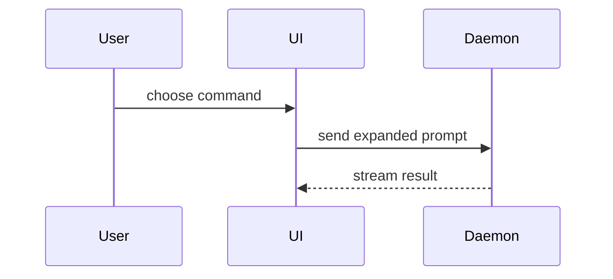

A PR body is read in one minute by someone deciding whether to merge. Write it **terse**: the fewest words and pictures that let them decide. Detail lives elsewhere: test output in CI, click-through screenshots in a PR comment, design in the ticket or ADR.

Use this template for writing the PR body:

```markdown
## Summary

<one sentence: what changes>

<one diagram, diff-sketch, or tree>

## Evidence

- **Before:** <screenshot/output/failing test>
  **After:** <screenshot/output/passing test>

## Merge Danger

**Door:** <one-way or two-way>, <one clause why>

**Blast Radius:** <one word>, <one clause naming who or what it touches>
```

## Limits

| Part | Limit |
|---|---|
| Summary | One sentence, then one visual. |
| Evidence | One before/after pair. At most 2 screenshots in the body; link to the rest. |
| Merge Danger | Two lines. |
| Whole body, visuals excluded | 120 words. |

Done when every limit holds. Over a limit: cut, or link to where the detail lives.

## Style

- Short sentences, plain words, the domain language from `GLOSSARY.md`.
- State what changes for the user or the code. Leave out how you worked, what you checked, file lists, test counts and repeats of the ticket.
- Bullets only for parallel items, one line each.

## Sections

### Summary

One sentence on what changes, then the single smallest view that makes it clear.

- Show logic or an algorithm as pseudocode:

```text
on(save)
  if content is unchanged
    return cached result
  write new content
  return fresh result
```

- Show runtime control flow as a call tree:

```text
submitForm
  createSession
    persistPrompt
    launchAgent
  navigateToSession
```

- Show UI structure as a component tree, including state and module boundaries that matter:

```text
<SessionPage> (apps/example/src/routes/session.tsx)
  useSessionEvents()
  <SessionToolbar>
    <RunSkillButton> (packages/ui)
```

- Show file responsibility or a broad refactor as a shallow file tree:

```text
src/
├── commands/       # parses user actions
├── sessions/       # owns session state
└── transport/      # sends API requests
```

- Show component interaction, control flow, or data flow with Mermaid:



- Use `diff` when the point is what changes and the surrounding shape already exists. Match the diff shape to the topic.

For a component change:

```diff
 <SessionPage>
   useSessionEvents()
   <SessionToolbar>
+    <RunSkillButton />
   <SessionTimeline>
+    <SkillResultCard />
```

For a file-layout change:

```diff
 src/
 ├── commands/
+│   └── show-me.ts       # expands the slash command
 ├── sessions/
-└── transport.ts
+└── transport/
+    ├── client.ts
+    └── stream.ts
```

For a call-tree or call-stack change:

```diff
 submitForm
   createSession
     persistPrompt
+    expandSkillMention
     launchAgent
-  navigateToSession
+  navigateToSession
+    subscribeToEvents
```

For a state or control-flow change:

```diff
 on(save)
-  write content
+  if content is unchanged
+    return cached result
+  write new content
+  invalidate cache
```

- Show the whole block when most of it is new, when omitted context would hide ownership or order, or when the user needs a copyable target shape:

```ts
function expandSkill(command: string): string {
  const skillName = command.slice(1);
  return `use the ${skillName} skill`;
}
```

#### Guidance

Place each visual next to the short text it supports. Keep only the calls, files, props, states, and boundaries needed to answer the user's current question or the options to resolve the current discussion point.

Use one view. Add a second only when the change has two parts a reviewer must see separately, such as a server rule and the screen that shows it.

### Evidence

One before/after pair that proves the change works.

Screenshots are S-tier when the change is visual. Annotate them: box, underline or highlight what changed. Put at most 2 in the body; a click-through with more lives in its own PR comment, linked in one line.

Execution-based evidence is A-tier: name the one test that fails before and passes after, in one line. CI shows the rest.

### Merge Danger

**Door:** a two-way door can be walked back by reverting; a one-way door can't (a migration that drops data, a message sent, a destructive action). Give the reason in one clause.

**Blast radius:** the scope of what could break, in one word plus one clause naming who or what it touches: e.g. "Contained, the student profile's Classes card." Consider layout shift, consumers of a changed API, mobile and existing data, but write down only what applies.
